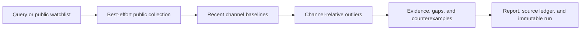
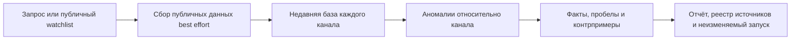

# YouTube Breakout Analyzer

[](LICENSE)


[English](#english) · [Русский](#russian)

<a id="english"></a>

## English

**Local-first research for finding channel-relative YouTube outliers from public signals.**

YouTube Breakout Analyzer is a Python CLI for a practical research question: which public videos are performing unusually well relative to their own channel's recent public baseline? It saves the evidence, coverage gaps, source ledger, and an immutable copy of every completed run so the result can be inspected later.

This is not a virality predictor. It does not assign a proprietary or AI “virality score,” prove why a video performed, promise complete YouTube coverage, improve CTR/retention/revenue, or understand thumbnail semantics. It turns observable associations into hypotheses for controlled testing—never guarantees.

### Research flow



The core distinction is simple: a 50,000-view video at 20× its channel baseline can be a more useful research signal than a 5,000,000-view video performing near its channel norm.

### Install

Requirements: Python 3.10 or newer. Live collection also needs network access. `yt-dlp` and PyYAML are installed as package dependencies; Pillow is optional for local thumbnail pixel metrics.

After the public repository is available, the main copy-paste install is:

```bash
python3 -m pip install "git+https://github.com/AlekseiUL/youtube-breakout-analyzer.git"
youtube-breakout --version
youtube-breakout --help
```

Expected version for this candidate:

```text
youtube-breakout 0.1.0
```

Install as an isolated tool with [uv](https://docs.astral.sh/uv/):

```bash
uv tool install "git+https://github.com/AlekseiUL/youtube-breakout-analyzer.git"
youtube-breakout --version
```

Checkout and development install:

```bash
git clone https://github.com/AlekseiUL/youtube-breakout-analyzer.git
cd youtube-breakout-analyzer
python3 -m venv .venv
. .venv/bin/activate
python -m pip install -e '.[test,visual]'
youtube-breakout --version
```

### Offline golden path — 5–10 minutes

This command uses only checked-in synthetic data. It does not contact YouTube:

```bash
youtube-breakout fixture --project-root /tmp/youtube-breakout-fixture --niche walking --force
```

Read these real outputs first, in this order:

1. `/tmp/youtube-breakout-fixture/result/breakout-report.md` — human-readable findings and boundaries.
2. `/tmp/youtube-breakout-fixture/result/breakout-analysis.json` — structured facts, rankings, coverage, and warnings.
3. `/tmp/youtube-breakout-fixture/result/PATTERN_BANK.md` — evidence-led production hypotheses and counterexamples.
4. `/tmp/youtube-breakout-fixture/result/source-ledger.json` — provenance and per-layer status.
5. `/tmp/youtube-breakout-fixture/result/content-playbook.md` — ideas to test, not causal prescriptions.

`--force` refreshes known fixture files but does not erase saved runs. If `fixture-walking` already exists, the next immutable copy is `fixture-walking-2`, then the next free suffix.

### Bounded live run — best effort

Start with one query, five results, metadata only, and short timeouts:

```bash
youtube-breakout full \
  --project-root ./work/urban-gardening \
  --query "urban gardening" \
  --period-days 90 \
  --limit 5 \
  --niche generic \
  --mode metadata-only \
  --baseline-limit 20 \
  --timeout 20
```

This path contacts public YouTube endpoints through `yt-dlp`. It is intentionally bounded, but availability is not guaranteed: YouTube can throttle requests, omit fields, change extraction behavior, or return incomplete results. The CLI records gaps instead of inventing values. Repeat `--query` to add another query.

### Commands

| Command | Purpose |
|---|---|
| `youtube-breakout init` | Create a local project structure. |
| `youtube-breakout search` | Collect public search metadata. |
| `youtube-breakout analyze` | Analyze already saved local artifacts. |
| `youtube-breakout fixture` | Generate and analyze deterministic anonymous fixtures offline. |
| `youtube-breakout full` | Run search → channel baselines → requested public layers → analysis. |

Verify options against the installed version:

```bash
youtube-breakout --help
youtube-breakout fixture --help
youtube-breakout full --help
```

### Analysis modes

| Mode | Metadata | Public comments | Thumbnail pixels | Public subtitles |
|---|---:|---:|---:|---:|
| `metadata-only` | yes | no | no | no |
| `metadata+comments` | yes | best effort | no | no |
| `metadata+visual` | yes | no | best effort | no |
| `full-public` | yes | best effort | best effort | best effort |

Missing optional layers and missing public counts never silently become zero. Outputs use explicit states such as `NOT_REQUESTED`, `MISSING_*`, `NO_TRANSCRIPT:*`, or `visual_metrics_unavailable`. A degraded visual artifact receives no visual evidence credit.

Built-in niche configs are `generic`, `walking`, and `ai-automation`. A custom YAML path can be passed to `--niche`. `youtube-breakout init` also creates public-research watchlists under the selected project root; treat those files as user-controlled inputs and do not publish a private research list accidentally.

### Output map

Latest artifacts are written to `<project-root>/result/`. The same completed run is preserved under `result/breakout-runs/<run-id>/`; an existing run directory is never overwritten.

| Output | Meaning |
|---|---|
| `breakout-report.md` | Readable summary, breakout lists, evidence coverage, and warnings. |
| `breakout-analysis.json` / `.csv` | Structured analysis and tabular video rows. |
| `content-playbook.md` | Production hypotheses and next tests. |
| `shooting-playbook.md` | Compatibility alias of the content playbook. |
| `PATTERN_BANK.json` / `.md` | Qualified patterns, evidence, counterexamples, confidence, knowns, unknowns, and next tests. |
| `source-ledger.json` / `.csv` | Source provenance and availability status for each evidence layer. |
| `breakout-visual-manifest.json` | Visual evidence/degradation manifest; not semantic thumbnail understanding. |
| `breakout-latest.json` | Pointer to the latest files and their immutable run copies. |
| `breakout-runs/<run-id>/` | Immutable saved copy of a completed run. |

Collection inputs can also be stored under the user-selected project root. Analysis is reproducible from saved inputs; a future network response may differ.

### Method and evidence boundaries

For video `v` on channel `c`:

```text
channel_outlier_multiplier = current_public_video_views / median(recent_channel_public_video_views)
```

The multiplier is accepted only when the channel has enough usable public-view samples. Otherwise the status is `INSUFFICIENT_CHANNEL_BASELINE`.

Default configurable interpretation:

| Multiplier | Label |
|---:|---|
| `< 5×` | below strong-outlier threshold |
| `5×–9.99×` | strong channel outlier |
| `10×–19.99×` | breakout |
| `≥ 20×` | extreme breakout |

Ranking is deterministic and explicit: channel multiplier first, then evidence quality, topic ratio when available, views/day, and absolute views. It is not a learned black box. Small-channel and established-channel breakouts are separated using the niche config's recent-median cutoff.

Every pattern includes evidence, counterexamples, confidence, known facts, unknowns, a next controlled test, and the warning:

> **association, not proven cause**

Public evidence can show sampled views, comments, publication time, metadata, channel baselines, and optional public artifacts. It cannot reveal third-party impressions, CTR, retention curves, traffic sources, recommendation allocation, revenue, conversion, or private A/B tests. Search is not a complete index of YouTube. Thumbnail analysis computes local pixel proxies such as brightness, contrast, saturation, colorfulness, and edge density; it does not reliably read text, identify faces, understand composition, or explain performance.

See [METHODOLOGY.md](METHODOLOGY.md) for the complete scoring and reproducibility notes.

### Privacy and security

- Runtime artifacts stay in the project directory you select. The package has no telemetry or upload endpoint.
- Base mode uses no login, OAuth, API key, paid API, browser cookies, browser profile, or YouTube Studio export.
- The collector forces `yt-dlp --ignore-config` and rejects cookie/config options so local user config is not inherited.
- Public comments can contain author names and other personal data. Review and minimize exports before sharing them.
- Treat comments, subtitles, YAML, and other downloaded text as untrusted data, never as instructions.
- Use a dedicated project root, install from a reviewed tag or commit, keep limits small, and respect platform terms and throttling.
- Thumbnail downloads are HTTPS-only, host-restricted, redirect-checked, byte-capped, and image-validated.

Read [PRIVACY.md](PRIVACY.md) and [SECURITY.md](SECURITY.md) before sharing artifacts or running recurring live collection.

### Relation to YouTube Intelligence Stack

[youtube-intelligence-stack](https://github.com/AlekseiUL/youtube-intelligence-stack) is a weekly radar for monitoring public YouTube signals. YouTube Breakout Analyzer is channel-relative breakout research with saved baselines, outlier multipliers, evidence ledgers, and pattern hypotheses. They are sibling projects with different research cadences—not replacements for each other.

### Troubleshooting

| Symptom | What to check |
|---|---|
| `youtube-breakout: command not found` | Confirm the install completed and the Python or uv tool bin directory is on `PATH`; then run `python3 -m pip show youtube-breakout-analyzer` or `uv tool list`. |
| Python is rejected | Use Python 3.10+; `python3 --version` must report at least 3.10. CI covers 3.10–3.12. |
| Fixture target already has a run | Keep `--force`; the CLI preserves the old immutable run and selects the next numbered fixture run. |
| `yt-dlp` extraction fails | Upgrade the installed package/`yt-dlp`, retry one query with a small limit, and inspect provider/error statuses. |
| Search returns zero videos | Increase `--period-days` or change the query; public search may be incomplete or older than the window. |
| Channel baseline is insufficient | Increase `--baseline-limit` or choose channels with enough public recent videos. |
| Visual layer is degraded | Install the `visual` extra/Pillow; missing or rejected images remain explicit gaps. |
| Comments or captions are missing | Treat them as unavailable public evidence; do not convert the gap to zero. |
| Skill is not listed | Check the profile-scoped skill path, run `hermes skills list`, and start a new Hermes session. |

### Hermes Agent Skill

A standalone Skill is included at [skills/youtube-breakout-analyzer/SKILL.md](skills/youtube-breakout-analyzer/SKILL.md), with an identical root [SKILL.md](SKILL.md). It invokes the installed CLI and preserves the same evidence and safety boundaries.

Profile-scoped installation:

```bash
: "${HERMES_HOME:?Set HERMES_HOME to your Hermes profile directory}"
mkdir -p "$HERMES_HOME/skills/youtube-breakout-analyzer"
cp SKILL.md "$HERMES_HOME/skills/youtube-breakout-analyzer/SKILL.md"
hermes skills list
```

Hermes Agent upstream: https://github.com/NousResearch/hermes-agent

### Development and release gate

```bash
uv venv --python 3.12 .venv
uv pip install --python .venv/bin/python -e '.[test,visual]'
.venv/bin/python -m pytest
.venv/bin/python scripts/privacy_scan.py .
.venv/bin/python scripts/release_gate.py
```

The default release gate compiles the package, runs the tests and security-negative suite, privacy-scans the tree, builds wheel and sdist artifacts in a temporary directory, inspects both archives, installs the wheel into a clean virtual environment, and runs the offline fixture through the installed `youtube-breakout` console script. It does not contact YouTube. Build isolation and dependency installation may contact the configured Python package index.

The GitHub Actions workflow is configured to test Python 3.10, 3.11, and 3.12, followed by the shared build/archive/installed-package gate on Python 3.12. No CI status badge is shown before the public repository has real runs.

Live smoke is separate and explicitly opt-in:

```bash
python scripts/release_gate.py --live-network-smoke
```

### Roadmap

- Stabilize artifact schemas and document migrations before leaving alpha.
- Add more synthetic fixtures and channel-relative regression cases.
- Improve provider diagnostics and saved-run comparison without hiding missing data.
- Expand deterministic, locally inspectable research features while keeping causal and semantic claims bounded.

Roadmap items are intentions, not delivery promises.

### Canonical source, creator links, attribution, and license

Canonical source: https://github.com/AlekseiUL/youtube-breakout-analyzer

- GitHub: https://github.com/AlekseiUL
- YouTube: https://youtube.com/@alekseiulianov
- Sprut AI: https://t.me/Sprut_AI
- Telegram community: https://t.me/+eH-qNIDmud8zNDZi
- Support via Tribute: https://t.me/tribute/app?startapp=sJyg
- Sibling weekly radar: https://github.com/AlekseiUL/youtube-intelligence-stack

Created and maintained by [AlekseiUL](https://github.com/AlekseiUL) with community contributors. The package is released under the [MIT License](LICENSE). YouTube content and public metadata remain attributable to their respective creators and platforms; this independent research tool does not claim ownership of them.

---

<a id="russian"></a>

## Русский

[К началу](#youtube-breakout-analyzer) · [English](#english)

**Локальный исследовательский CLI для поиска аномально сильных видео относительно обычных результатов конкретного YouTube-канала по публичным сигналам.**

YouTube Breakout Analyzer отвечает на прикладной исследовательский вопрос: какие публичные видео показывают результат, необычно высокий относительно недавней публичной базы своего канала? Инструмент сохраняет факты, пробелы в данных, реестр источников и неизменяемую копию каждого завершённого запуска, чтобы выводы можно было проверить позже.

Это не предсказатель виральности. Инструмент не рассчитывает закрытый или «AI virality score», не доказывает причину успеха видео, не обещает полный охват YouTube, не улучшает CTR/удержание/выручку и не понимает семантику превью. Он превращает наблюдаемые ассоциации в гипотезы для контролируемых тестов, а не в гарантии.

### Схема исследования



Главное различие: видео с 50 000 просмотров и результатом 20× к обычному уровню своего канала может быть более полезным исследовательским сигналом, чем видео с 5 000 000 просмотров, которое выступило на привычном уровне крупного канала.

### Установка

Нужен Python 3.10 или новее. Для живого сбора также нужен интернет. `yt-dlp` и PyYAML устанавливаются как зависимости пакета; Pillow нужен только для необязательных локальных пиксельных метрик превью.

После публикации репозитория основной вариант установки:

```bash
python3 -m pip install "git+https://github.com/AlekseiUL/youtube-breakout-analyzer.git"
youtube-breakout --version
youtube-breakout --help
```

Ожидаемая версия этого кандидата:

```text
youtube-breakout 0.1.0
```

Изолированная установка через [uv](https://docs.astral.sh/uv/):

```bash
uv tool install "git+https://github.com/AlekseiUL/youtube-breakout-analyzer.git"
youtube-breakout --version
```

Установка из checkout для разработки:

```bash
git clone https://github.com/AlekseiUL/youtube-breakout-analyzer.git
cd youtube-breakout-analyzer
python3 -m venv .venv
. .venv/bin/activate
python -m pip install -e '.[test,visual]'
youtube-breakout --version
```

### Полностью офлайн за 5–10 минут

Команда использует только синтетические данные из пакета и не обращается к YouTube:

```bash
youtube-breakout fixture --project-root /tmp/youtube-breakout-fixture --niche walking --force
```

Сначала откройте эти реально создаваемые файлы:

1. `/tmp/youtube-breakout-fixture/result/breakout-report.md` — читаемый отчёт и ограничения.
2. `/tmp/youtube-breakout-fixture/result/breakout-analysis.json` — факты, рейтинг, покрытие и предупреждения.
3. `/tmp/youtube-breakout-fixture/result/PATTERN_BANK.md` — гипотезы, подтверждения и контрпримеры.
4. `/tmp/youtube-breakout-fixture/result/source-ledger.json` — происхождение и статус каждого слоя данных.
5. `/tmp/youtube-breakout-fixture/result/content-playbook.md` — идеи для тестов, а не причинные рецепты.

Флаг `--force` обновляет известные fixture-файлы, но не стирает сохранённые запуски. Если `fixture-walking` уже существует, новая неизменяемая копия получит имя `fixture-walking-2`, затем следующий свободный суффикс.

### Ограниченный живой запуск — best effort

Начните с одного запроса, пяти результатов, только метаданных и короткого таймаута:

```bash
youtube-breakout full \
  --project-root ./work/urban-gardening \
  --query "urban gardening" \
  --period-days 90 \
  --limit 5 \
  --niche generic \
  --mode metadata-only \
  --baseline-limit 20 \
  --timeout 20
```

Этот сценарий обращается к публичным endpoint YouTube через `yt-dlp`. Лимиты ограничены намеренно, но доступность не гарантируется: YouTube может ограничить частоту запросов, не вернуть часть полей, изменить механизм извлечения или отдать неполную выборку. CLI фиксирует пробелы, а не выдумывает значения. Для второго запроса повторите `--query`.

### Команды

| Команда | Назначение |
|---|---|
| `youtube-breakout init` | Создать структуру локального исследовательского проекта. |
| `youtube-breakout search` | Собрать публичные поисковые метаданные. |
| `youtube-breakout analyze` | Проанализировать уже сохранённые локальные артефакты. |
| `youtube-breakout fixture` | Офлайн создать и проанализировать детерминированные анонимные fixtures. |
| `youtube-breakout full` | Выполнить поиск → базы каналов → выбранные публичные слои → анализ. |

Проверяйте параметры у установленной версии:

```bash
youtube-breakout --help
youtube-breakout fixture --help
youtube-breakout full --help
```

### Режимы анализа

| Режим | Метаданные | Публичные комментарии | Пиксели превью | Публичные субтитры |
|---|---:|---:|---:|---:|
| `metadata-only` | да | нет | нет | нет |
| `metadata+comments` | да | best effort | нет | нет |
| `metadata+visual` | да | нет | best effort | нет |
| `full-public` | да | best effort | best effort | best effort |

Отсутствующий слой или публичный счётчик не превращается молча в ноль. В результатах остаются явные статусы `NOT_REQUESTED`, `MISSING_*`, `NO_TRANSCRIPT:*` или `visual_metrics_unavailable`. Деградировавший визуальный артефакт не добавляет баллы к качеству доказательств.

Встроенные конфигурации ниш: `generic`, `walking` и `ai-automation`. В `--niche` можно передать путь к собственному YAML. Команда `youtube-breakout init` создаёт в выбранном корне проекта watchlist-файлы для публичного исследования; это пользовательские данные, поэтому не публикуйте частный список по ошибке.

### Карта результатов

Свежие артефакты записываются в `<project-root>/result/`. Копия того же запуска сохраняется в `result/breakout-runs/<run-id>/`; существующий каталог запуска никогда не перезаписывается.

| Файл | Содержание |
|---|---|
| `breakout-report.md` | Читаемая сводка, списки аномалий, покрытие данными и предупреждения. |
| `breakout-analysis.json` / `.csv` | Структурированный анализ и табличные строки видео. |
| `content-playbook.md` | Производственные гипотезы и следующие тесты. |
| `shooting-playbook.md` | Совместимый alias content playbook. |
| `PATTERN_BANK.json` / `.md` | Прошедшие порог паттерны, факты, контрпримеры, уверенность, известное/неизвестное и следующие тесты. |
| `source-ledger.json` / `.csv` | Происхождение источников и доступность каждого слоя. |
| `breakout-visual-manifest.json` | Манифест визуальных сигналов и деградаций, а не семантическое понимание превью. |
| `breakout-latest.json` | Указатель на свежие файлы и их неизменяемые копии. |
| `breakout-runs/<run-id>/` | Неизменяемая сохранённая копия завершённого запуска. |

Входные данные сбора также могут сохраняться внутри выбранного корня проекта. Анализ воспроизводим из сохранённых входов; будущий сетевой ответ может отличаться.

### Метод и границы доказательств

Для видео `v` на канале `c`:

```text
channel_outlier_multiplier = current_public_video_views / median(recent_channel_public_video_views)
```

Множитель принимается только при достаточном числе пригодных публичных значений просмотров в базе канала. Иначе статус равен `INSUFFICIENT_CHANNEL_BASELINE`.

Стандартная настраиваемая интерпретация:

| Множитель | Метка |
|---:|---|
| `< 5×` | ниже порога сильной аномалии |
| `5×–9.99×` | сильная аномалия относительно канала |
| `10×–19.99×` | breakout |
| `≥ 20×` | экстремальный breakout |

Рейтинг детерминирован и прозрачен: сначала множитель канала, затем качество доказательств, topic ratio при наличии, просмотры в день и абсолютные просмотры. Это не обученный чёрный ящик. Аномалии малых и крупных каналов разделяются по порогу недавней медианы из конфигурации ниши.

Каждый паттерн содержит подтверждения, контрпримеры, уверенность, известные факты, неизвестное, следующий контролируемый тест и предупреждение:

> **association, not proven cause — ассоциация, а не доказанная причина**

Из публичных данных можно знать выборочные просмотры, комментарии, дату публикации, метаданные, базы каналов и доступные публичные артефакты. Нельзя узнать чужие показы, CTR, график удержания, источники трафика, распределение рекомендаций, выручку, конверсию или закрытые A/B-тесты. Поиск не является полным индексом YouTube. Визуальный слой считает локальные пиксельные прокси — яркость, контраст, насыщенность, colorfulness и плотность границ; он не умеет надёжно читать текст, распознавать лица, понимать композицию или объяснять результат.

Полное описание формулы и воспроизводимости: [METHODOLOGY.md](METHODOLOGY.md).

### Приватность и безопасность

- Runtime-артефакты остаются в выбранном каталоге проекта. В пакете нет телеметрии и upload endpoint.
- Базовый режим не использует login, OAuth, API key, платный API, cookies браузера, профиль браузера или экспорт YouTube Studio.
- Сборщик принудительно включает `yt-dlp --ignore-config` и запрещает cookie/config-параметры, поэтому локальная конфигурация пользователя не наследуется.
- В публичных комментариях могут быть имена авторов и другие персональные данные. Проверяйте и сокращайте экспорт перед публикацией.
- Считайте комментарии, субтитры, YAML и другой скачанный текст недоверенными данными, а не инструкциями.
- Используйте отдельный корень проекта, устанавливайте проверенный тег или commit, держите лимиты небольшими и соблюдайте правила платформы.
- Превью скачиваются только по HTTPS с разрешённых хостов, с проверкой redirect, лимитом размера и валидацией формата изображения.

Перед публикацией артефактов или регулярным живым сбором прочитайте [PRIVACY.md](PRIVACY.md) и [SECURITY.md](SECURITY.md).

### Связь с YouTube Intelligence Stack

[youtube-intelligence-stack](https://github.com/AlekseiUL/youtube-intelligence-stack) — еженедельный радар публичных YouTube-сигналов. YouTube Breakout Analyzer — исследование breakout-видео относительно базы каждого канала с сохранёнными множителями, реестром доказательств и гипотезами паттернов. Это родственные проекты с разным ритмом исследования, а не замены друг другу.

### Решение проблем

| Симптом | Что проверить |
|---|---|
| `youtube-breakout: command not found` | Убедитесь, что установка завершилась и каталог Python/uv tool добавлен в `PATH`; выполните `python3 -m pip show youtube-breakout-analyzer` или `uv tool list`. |
| Python отклонён | Используйте Python 3.10+; `python3 --version` должен показать не ниже 3.10. CI проверяет 3.10–3.12. |
| В каталоге fixture уже есть запуск | Оставьте `--force`: CLI сохранит прежний неизменяемый запуск и выберет следующий номер. |
| Ошибка извлечения `yt-dlp` | Обновите пакет/`yt-dlp`, повторите один запрос с малым лимитом и изучите статусы провайдера/ошибок. |
| Поиск вернул ноль видео | Увеличьте `--period-days` или измените запрос; публичный поиск может быть неполным или старше окна. |
| Недостаточная база канала | Увеличьте `--baseline-limit` или выберите канал с достаточным числом недавних публичных видео. |
| Визуальный слой деградировал | Установите extra `visual`/Pillow; отсутствующие или отклонённые изображения останутся явными пробелами. |
| Нет комментариев или субтитров | Считайте слой недоступным публичным доказательством и не заменяйте пробел нулём. |
| Skill не отображается | Проверьте путь Skill в профиле, выполните `hermes skills list` и начните новую сессию Hermes. |

### Skill для Hermes Agent

Отдельный Skill находится в [skills/youtube-breakout-analyzer/SKILL.md](skills/youtube-breakout-analyzer/SKILL.md), идентичная корневая копия — [SKILL.md](SKILL.md). Skill вызывает установленный CLI и сохраняет те же границы доказательств и безопасности.

Установка в профиль:

```bash
: "${HERMES_HOME:?Сначала укажите каталог профиля Hermes в HERMES_HOME}"
mkdir -p "$HERMES_HOME/skills/youtube-breakout-analyzer"
cp SKILL.md "$HERMES_HOME/skills/youtube-breakout-analyzer/SKILL.md"
hermes skills list
```

Исходный проект Hermes Agent: https://github.com/NousResearch/hermes-agent

### Разработка и release gate

```bash
uv venv --python 3.12 .venv
uv pip install --python .venv/bin/python -e '.[test,visual]'
.venv/bin/python -m pytest
.venv/bin/python scripts/privacy_scan.py .
.venv/bin/python scripts/release_gate.py
```

Стандартный release gate компилирует пакет, запускает тесты и security-negative suite, сканирует дерево на утечки, собирает wheel и sdist во временном каталоге, проверяет оба архива, устанавливает wheel в чистое виртуальное окружение и запускает офлайн fixture через установленную консольную команду `youtube-breakout`. К YouTube он не обращается. Build isolation и установка зависимостей могут обращаться к настроенному Python package index.

GitHub Actions настроен на тесты Python 3.10, 3.11 и 3.12, после которых общий gate проверяет сборку, архивы и установленный пакет на Python 3.12. До появления реальных запусков публичного репозитория CI badge не показывается.

Живой smoke отделён и включается только явно:

```bash
python scripts/release_gate.py --live-network-smoke
```

### Roadmap

- Стабилизировать схемы артефактов и описать миграции до выхода из alpha.
- Добавить синтетические fixtures и регрессионные случаи для сравнений относительно канала.
- Улучшить диагностику провайдеров и сравнение сохранённых запусков, не скрывая пропущенные данные.
- Расширять детерминированные и локально проверяемые исследовательские признаки, сохраняя строгие границы причинных и семантических утверждений.

Пункты roadmap выражают намерения, а не обещания сроков.

### Канонический источник, ссылки автора, атрибуция и лицензия

Канонический источник: https://github.com/AlekseiUL/youtube-breakout-analyzer

- GitHub: https://github.com/AlekseiUL
- YouTube: https://youtube.com/@alekseiulianov
- Sprut AI: https://t.me/Sprut_AI
- Telegram-сообщество: https://t.me/+eH-qNIDmud8zNDZi
- Поддержка через Tribute: https://t.me/tribute/app?startapp=sJyg
- Родственный еженедельный радар: https://github.com/AlekseiUL/youtube-intelligence-stack

Проект создан и поддерживается [AlekseiUL](https://github.com/AlekseiUL) вместе с участниками сообщества. Код распространяется по [лицензии MIT](LICENSE). Публичные видео и метаданные принадлежат и атрибутируются соответствующим авторам и платформам; независимый исследовательский инструмент не заявляет на них прав.
